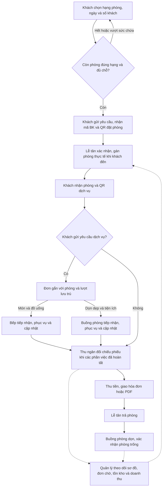

# GOLDEN HAVEN · Hệ thống dịch vụ phòng bằng QR

## Chạy từ VS Code

**Không dùng nút Go Live / Live Server** để vận hành. Go Live chỉ phục vụ tệp HTML ở cổng 5500, không chạy API đăng nhập, phòng, đặt món hay dữ liệu dùng chung. Mở terminal trong thư mục dự án `Smart-Hotel-Room-Service-System`, chạy `npm start`, rồi dùng `http://localhost:3000`. Nếu cổng 3000 đang có máy chủ khách sạn, lệnh báo máy chủ đó đã chạy và không mở thêm cổng 3001. Nếu cổng bị ứng dụng khác chiếm, hãy đóng ứng dụng đó trước khi chạy lại.

Nếu đang mở trang bằng cổng 5500, trang sẽ tự tìm máy chủ Node đang chạy rồi chuyển sang đúng địa chỉ. Nếu máy chủ chưa bật, trang sẽ hiện hướng dẫn khởi chạy.

## Các trang

- `home.html`: trang chủ khách sạn, tiện ích và gửi yêu cầu đặt phòng.
- `bo-phan.html`: cổng nội bộ để chọn bộ phận, đăng xuất và đổi tài khoản/bộ phận.
- `khach-hang.html`: thực đơn dịch vụ khách lưu trú mở từ QR. Mã QR có tham số `?room=101` để gắn yêu cầu đúng phòng.
- `index.html`: đường dẫn cũ, tự chuyển sang trang khách/QR.
- `letan.html`: tiếp tân xem phòng trống, nhận/trả khách, duyệt yêu cầu đặt phòng và tạo QR phòng.
- `thu-ngan.html`: thu ngân theo dõi dịch vụ đã hoàn tất, áp dụng ưu đãi và quyết toán hóa đơn.
- `van-hanh.html`: trang công việc chung có hai mục Bếp & Ẩm thực và Buồng phòng. Tài khoản bếp chỉ thấy mục bếp; tài khoản buồng phòng chỉ thấy mục buồng phòng; quản lý xem được cả hai.
- `bep.html` và `buongphong.html`: đường dẫn cũ, tự chuyển về đúng mục trong `van-hanh.html`.
- `manager.html`: quản lý xem doanh thu, sơ đồ phòng, tồn kho, việc cần xử lý và mở mọi bộ phận.

Tiếp tân và thu ngân là hai công việc/tài khoản riêng, cùng dùng dữ liệu phòng và hóa đơn. Lễ tân có thể xác nhận đã thu tiền dịch vụ rồi trả phòng; thu ngân cũng có thể quyết toán hóa đơn. Không thể trả phòng khi còn hóa đơn chưa thanh toán hoặc dịch vụ chưa hoàn tất. Bộ phận bếp/buồng phòng cập nhật phục vụ tại trang điều phối chung; quản lý xem báo cáo tổng hợp và cả hai mục vận hành.

Sau khi nhận phòng, lễ tân xem QR trong cửa sổ riêng. Bấm **Xong · quay lại sơ đồ phòng** để làm thủ tục khách kế tiếp. Trang QR dành cho khách không có nút đăng nhập nhân viên; dùng `bo-phan.html` để vào khu vực nội bộ.

## Tài khoản demo trên máy cá nhân

| Bộ phận | Tài khoản | Mật khẩu |
| --- | --- | --- |
| Tiếp tân | `letan` | `123456` |
| Thu ngân | `thungan` | `123456` |
| Buồng phòng | `buongphong` | `123456` |
| Bếp | `bep` | `123456` |
| Quản lý | `quanly` | `123456` |

Mật khẩu trong bảng là mặc định khi chạy trên máy cá nhân. Trên Render, mật khẩu của từng tài khoản được cấu hình theo phần triển khai bên dưới.

## Chạy một lượt từ đặt phòng đến trả phòng

1. **Khách** chọn ngày và loại phòng ở trang chủ, xem số phòng còn theo lịch rồi gửi yêu cầu. Lưu mã `BK-...` hoặc tải **QR đặt phòng** để xem trạng thái và đưa cho lễ tân khi đến. Yêu cầu mới ở trạng thái chờ xác nhận.
2. **Lễ tân** xét yêu cầu và xác nhận. Khi khách đến, tra cứu đúng mã `BK-...` và chọn phòng trống đúng hạng. Có thể nhập mã nếu camera trong trình duyệt không hỗ trợ quét. Sau khi check-in, đưa khách QR dịch vụ phòng và PIN dự phòng.
3. **Khách lưu trú** dùng camera điện thoại quét **QR dịch vụ phòng**, chọn món hoặc tiện ích, rồi gửi yêu cầu. Khách có thể xem trạng thái phục vụ trên trang dịch vụ.
4. **Bếp** nhận món và đồ uống. **Buồng phòng** nhận dọn dẹp và tiện ích. Khi có nhiều khách, xử lý theo thứ tự yêu cầu trong mỗi trạng thái, đối chiếu số phòng và mã đơn trước khi giao. Bấm **Tiếp nhận phục vụ** rồi **Hoàn tất phục vụ**. Đơn có hai nhóm dịch vụ sẽ sẵn sàng thu khi cả hai bộ phận hoàn tất.
5. **Thu ngân** tìm số phòng trong **Phiếu quyết toán theo phòng**, đối chiếu tiền phòng, dịch vụ và khoản đã thu trước. Sau khi thực nhận tiền, bấm **Xác nhận đã thu tiền** rồi in hóa đơn hoặc lưu PDF. **Lễ tân** xác nhận trả phòng; **buồng phòng** xác nhận đã dọn để phòng về trạng thái trống.
6. **Quản lý** theo dõi doanh thu đã thu, lịch phòng, đơn cần xử lý và cảnh báo tồn kho. Khi nhiều phòng dùng dịch vụ cùng lúc, quản lý ưu tiên đơn chờ lâu, điều phối nhân viên dọn phòng cần quay vòng và cập nhật tồn kho sau khi đối chiếu thực tế.

Khi chạy trên máy tính, kết nối điện thoại cùng Wi-Fi và mở địa chỉ IP LAN hiển thị cạnh QR, với cổng của máy chủ (mặc định 3000). Nếu đổi mạng hoặc đổi cổng, tạo lại mã. Có thể mở lại booking bằng mã `BK-...` để tải QR mới. Khi sử dụng web đã triển khai, mở trang chủ và lễ tân từ địa chỉ HTTPS của website để mã trỏ về cùng tên miền.

Ảnh minh họa món ăn và dịch vụ có ghi [nguồn ảnh](assets/menu/SOURCES.md).
Các hạng Tiêu chuẩn, Deluxe và Suite trong bản demo lần lượt có 22, 32, 48 m² và tối đa 2, 3, 4 khách. [Nguồn ảnh hạng phòng](assets/rooms/SOURCES.md).

## Trợ lý GOLDEN HAVEN và chế độ demo

- Trợ lý giữ ngữ cảnh vài câu gần nhất trong tab. Ví dụ, hỏi giá phòng Deluxe rồi hỏi tiếp “Vậy 2 đêm bao nhiêu?”. Giá, số phòng theo ngày và món ăn lấy từ hệ thống khách sạn. Câu hỏi về thông tin riêng của lượt lưu trú được chuyển về quy trình tra cứu và lễ tân.
- Trên Windows, `start-pos.bat` cũng khởi động Qwen nếu có đúng tệp trong thư mục `.golden-haven-ai` nằm cạnh dự án. Thư mục này chứa `llama-cpu/llama-server.exe` từ [llama.cpp](https://github.com/ggml-org/llama.cpp) và bản GGUF của [Qwen2.5 Instruct](https://huggingface.co/Qwen/Qwen2.5-0.5B-Instruct-GGUF). Mô hình lắng nghe ở `127.0.0.1:8189`; mã và giá chính thức vẫn do web xác định.
- Để nối một dịch vụ mô hình trên môi trường khác, đặt `HOTEL_AI_ENDPOINT` thành URL chat completions và `HOTEL_AI_MODEL` thành tên mô hình của dịch vụ. `HOTEL_AI_KEY` là khóa nếu dịch vụ yêu cầu. Khi endpoint chưa có hoặc bận, trang vẫn tra cứu theo dữ liệu khách sạn.
- VietQR ở quầy chỉ hiện khi khai báo `HOTEL_BANK_ID`, `HOTEL_BANK_ACCOUNT` và `HOTEL_BANK_NAME` theo tài khoản đã xác minh. Nhân viên xác nhận sau khi thực nhận tiền.
- `npm test` chạy máy chủ thử với dữ liệu riêng để kiểm tra đặt trùng phòng, tồn kho, phân quyền, quyết toán và trả phòng. Khi mở cho khách thật, cần cấu hình tài khoản riêng và kho lưu trữ bền vững cho dữ liệu khách, đơn và hóa đơn.

## Triển khai bản demo lên Render

1. Đưa phiên bản đã kiểm tra bằng `npm ci` và `npm test` lên nhánh `main` của GitHub. Kho mã nguồn chỉ chứa dữ liệu khởi tạo mẫu. Dữ liệu lưu trú trên máy và mật khẩu triển khai được lưu riêng.
2. Với dịch vụ mới, vào [Render Dashboard](https://dashboard.render.com/) và chọn **New → Blueprint**, kết nối kho GitHub rồi chọn `render.yaml`. Blueprint khai báo Web Service **Free**, Node.js `24.22.1`, lệnh build `npm ci`, lệnh chạy `npm start` và kiểm tra sức khỏe tại `/api/health`. Nếu dịch vụ đã tồn tại, đối chiếu các mục tương ứng trong **Settings** của dịch vụ đó. [Tài liệu Blueprint](https://render.com/docs/blueprint-spec)
3. Điền một mật khẩu mới cho mỗi bộ phận, mỗi mật khẩu ít nhất 12 ký tự và dùng riêng cho bộ phận đó. Nhập giá trị khi tạo Blueprint hoặc trong **Environment** của dịch vụ đã có, sau đó triển khai lại. [Tài liệu biến môi trường](https://render.com/docs/configure-environment-variables)

   | Bộ phận | Tài khoản | Biến chứa mật khẩu |
   | --- | --- | --- |
   | Lễ tân | `letan` | `HOTEL_STAFF_RECEPTIONIST_PASSWORD` |
   | Thu ngân | `thungan` | `HOTEL_STAFF_CASHIER_PASSWORD` |
   | Bếp | `bep` | `HOTEL_STAFF_KITCHEN_PASSWORD` |
   | Buồng phòng | `buongphong` | `HOTEL_STAFF_HOUSEKEEPING_PASSWORD` |
   | Quản lý | `quanly` | `HOTEL_STAFF_MANAGER_PASSWORD` |

4. Khi Render báo **Live**, mở URL HTTPS của dịch vụ. Mở `/api/health` để kiểm tra `ok: true`, vào `/bo-phan.html` để kiểm tra đăng nhập, rồi tạo booking mẫu và quét cả QR đặt phòng lẫn QR dịch vụ bằng điện thoại. Thử hoàn tất yêu cầu ở Bếp và Buồng phòng, ghi nhận thanh toán mẫu ở Thu ngân, in hóa đơn, trả phòng ở Lễ tân và đối chiếu doanh thu ở Quản lý.

Để viết báo cáo, chụp màn hình cấu hình dịch vụ, log triển khai thành công, trang chủ, QR đặt phòng, check-in, giao việc, hóa đơn và bảng doanh thu. Giữ thông tin đăng nhập ngoài ảnh chụp. Bản demo dùng dữ liệu giả, trợ lý tra cứu dữ liệu khách sạn khi chưa khai báo dịch vụ mô hình và quầy có thể ghi nhận tiền mặt mẫu.

Render Free đưa dịch vụ vào chế độ ngủ sau 15 phút vắng lưu lượng. `data.json` trên Render có thể mất khi dịch vụ ngủ, khởi động lại hoặc triển khai lại. Với bản demo, tạo dữ liệu mẫu ngay trong buổi trình bày. Chuyển dữ liệu sang cơ sở dữ liệu bền vững trước khi dùng cho khách thật. [Giới hạn Render Free](https://render.com/docs/free)
